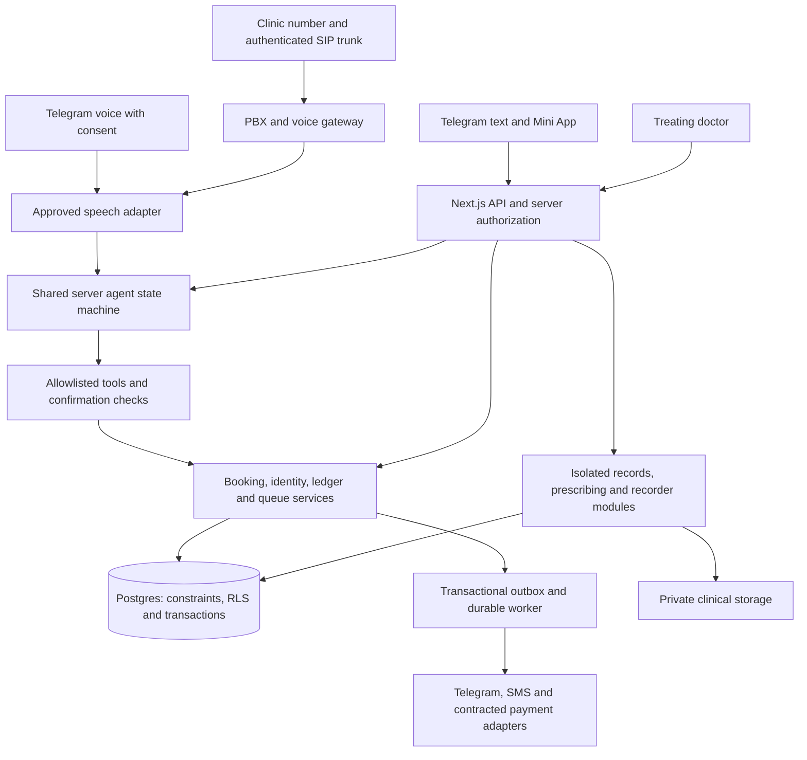

# Health AI: specification analysis and implementation blueprint

Prepared 20 November 2026, Asia/Tashkent. Status: proposed implementation plan, not a release approval.

Source: Health-AI-Technical-Specification.pdf, version 1.1 draft dated 14 November 2026, 38 pages. Page references below refer to the PDF's printed page numbers. Repository observations refer to the local working tree inspected on 20 November; external documentation was checked on that date.

## 1. Executive assessment

The specification is feasible as an extension of the existing clinic product. Keep the Next.js application, Supabase/Postgres, transactional booking engine, outpatient queue, laboratory domain and append-only payment ledger. Add a shared agent orchestrator, a durable worker, a separate voice gateway, and carefully isolated doctor-document workflows. A backend rewrite would increase migration and authorization risk without solving the identified problems.

The business outcome is one operational system across desk, Telegram and phone, while preserving distinct rules for scheduled reservations, walk-in encounters, identity proof, money, and doctor-authored records. The most difficult work is preserving these boundaries under concurrency, retries, partial failures and uncertain speech recognition.

Recommended delivery sequence:

1. Establish a reproducible code/schema baseline and complete the blocking audit work.
2. Encrypt identity data, rehearse hosting/restore, and pilot desk, kassa, queue and notifications.
3. Enable verified online booking with pay-at-clinic and contracted SMS. OneID is optional until its agreement is ready.
4. Add contracted Rahmat payments and explicit hold/expiry/refund handling.
5. Build the shared text agent and requests inbox; then Telegram voice; then after-hours phone AI.
6. Develop structured doctor prescribing and verified patient document delivery as a separate track. Pilot the consultation recorder last, after stronger evidence checks and speech evaluation.

Do not interpret the PDF's instructions to deploy, change rules or contact providers as authorization to execute those actions. This review creates planning artifacts only. The current user-supplied AGENTS.md governs the design. No application code, live data, configuration, contracts or deployment were changed.

### What is already reusable

Booking and slot calculation, patient identity linking, doctor access controls, immutable clinical records, laboratory access and release, online invoice settlement primitives, manual kassa accounting, notification infrastructure, and local E2E infrastructure all have source implementations. Their existence reduces scope; it does not establish that the current deployment passes release gates.

### What needs the most attention

The canonical branch/schema is unresolved as a deployment fact; claim ownership is only partially integrated in sampled notification code; identity fields still have plaintext workflows; real Rahmat and Aisha adapters are absent; and prescribing, consultation recording and general patient-document delivery need new domain models. Several requirements conflict with the current privacy rules or with one another. Resolve them in section 3 before coding those behaviors.

## 2. Evidence and current implementation gaps

All 38 PDF pages were extracted and read. The cover and identity diagram were rendered for layout verification. This is a design and sampled source review, not a live database audit or a full code security audit. No environment files or patient rows were read. No production access, release checks, model evaluation or vendor sandbox calls were performed.

The PDF records main at `990d082` and a heavily divergent pilot branch (pp. 1, 3). This checkout identifies as `codex/clinic-operations-pilot`, HEAD `5d7ef45`, with extensive existing tracked and untracked changes. Against the local `main` ref, `git rev-list --left-right --count HEAD...main` returned `17 0`. These local refs do not establish the current GitHub or deployed revision. Preserve the working tree; do not repeat the PDF's historical divergence counts as current facts.

| Capability | Observed evidence | Implementation consequence |
| --- | --- | --- |
| Transactional booking and concurrency protection | `src/lib/booking/engine.ts`; unified booking migrations and DB/concurrency suites | Reuse for scheduled reservations from every channel; extend source enums and confirmation contracts. |
| Walk-in consultation repair | Local migration `20261116000001_walk_in_encounter.sql` introduces `queue_encounter` and `open_queue_encounter()` | Repair exists locally; rehearse migration against the canonical schema and prove that ordinary bookings retain exclusion protection. Deployment not verified. |
| Webhook claim ownership | `src/lib/telegram/idempotency.ts` passes claim tokens; migration `20261116000003_claim_ownership.sql`; claim-ownership test source | Good foundation. Verify token ownership before side effects as well as finalization; prove stale-worker behavior in the deployed lineage. |
| Notification/SMS leases and quarantine | November 16 migration stamps tokens, rejects NULL limits and adds quarantine | Sampled `processor.ts` and SMS `finish()` still update jobs by id without token fencing. Migration alone does not finish the end-to-end protocol. |
| Identity lookup and proof | `src/lib/patients/online-identity.ts`, `src/lib/identity/oneid.ts`, online-identity migrations | Reuse proof semantics; rewrite plaintext comparison/RPC paths for encryption. OneID contract and live behavior remain unverified. |
| Identity encryption | Plaintext identity selections and SQL comparisons remain in the sampled paths | ID-07 is a real migration project, including transient lookup/claim tables, not merely encrypting four patient columns. |
| Online money | `src/lib/payments/online/service.ts`, `types.ts`, invoice/settlement migrations | Reuse accounting invariants. Current interface exposes checkout and webhook verification; status/refund operations requested by the PDF need a deliberate interface extension. |
| Rahmat | `src/lib/payments/online/rahmat.ts` always reports unconfigured, throws on checkout and rejects webhooks | Unimplemented fail-closed stub. Do not estimate it as credential activation only. |
| Speech | `src/lib/transcription/provider.ts` implements OpenAI-compatible batch transcription and a health-audio allowlist | Aisha's native protocol and live streaming need adapters; a changed base URL alone is insufficient. |
| Concern routing | `src/lib/booking/router.ts` has deterministic multilingual cues matched to clinic specialties | Reuse matcher; add approved per-clinic routing configuration and explicit unavailable-direction behavior. |
| Clinical records and access | `src/lib/clinical-records/service.ts`, clinical-access helpers and referral lifecycle | Preserve author/consultation provenance, correction chains and expiry-aware read authorization. |
| Laboratory AI | `src/lib/labs/ai/facts.ts`, `rewrite.ts`, `assist.ts` | Reuse the separation between verified facts and optional wording. Do not reuse its validator as proof of clinical transcript fidelity. |
| New doctor tools | No structured prescribing/recorder/delivery models found in inspected generated types and corresponding paths | Implement as new bounded modules; generic free-text clinical records do not satisfy the structured requirements. |
| Hosting | `deploy/uz/README.md` and deployment kit exist | Rehearsal, security configuration, capacity measurement and cutover evidence are still required. The kit removes Realtime, so a polling inbox is the simplest compatible first release. |
| Release evidence | CI defines static checks, local DB suites, production build and E2E | Historical README/audit approval language is not evidence for this changed tree. The PDF's November 14 audit explicitly describes drift and open findings. |

## 3. Resolve specification conflicts before implementation

These are proposed clarifications. Existing AGENTS.md restrictions remain effective while broader changes await an explicit decision.

| Issue | Why literal implementation fails | Recommended interpretation or amendment |
| --- | --- | --- |
| ID-05 treats caller ID plus DOB as proof (pp. 9-11) | Caller ID is a routing/risk signal, not demonstrated control of the stored number. DOB is often known. | Require a one-time challenge sent to the stored phone, OneID or a verified existing patient session before linking/disclosing an existing card or changing its bookings. Unverified callers can request a provisional new booking or callback without existing-card disclosure. |
| SC-07 grants referred doctors draft/transcript access after signing (p. 23) | Conflicts with the treating-doctor-only rule in AGENTS.md, the access table and draft-table description. | Drafts, audio and transcripts remain treating-doctor-only throughout their lifetime. Referred doctors see only the signed record when existing clinical access permits. |
| Recorder produces medicine/test “suggestions” (p. 22) versus RX-03 no AI prescribing | A model-generated choice can become an implicit treatment recommendation. | Show only source-linked mentions of exactly what was stated; no recommended medicines, doses, durations or tests. Require deterministic catalogue match and field-by-field doctor entry/confirmation before a draft order exists. |
| Matching words/numbers is described as a fact check (SC-03) | A transcript can contain a medicine while saying “do not take it”; numbers can belong to a different medicine or speaker. STT can also mishear the original audio. | Validate complete assertions with speaker, negation, temporality, subject, units and source spans. Withhold unverified claims. Retain manual typing as the safe fallback; doctor review still checks recognition accuracy. |
| “Send” defaults on (D-13, p. 36) | D-13 is a proposal; D-14 requires that the treating doctor choose release. | Use an explicit sign-and-send action with item selection, or sign then release. Plain sign does not send until the owner approves a clearly visible default and release semantics. |
| Reception “print only” for prescriptions (p. 13) | Providing a plaintext PDF to a reception browser reveals its contents. | Patient/doctor print first. An operational print service would require a separately approved, auditable access model; do not silently grant staff document reads. |
| Call-recording notice versus explicit consent (pp. 8, 18) | “May be recorded” is not an affirmative permission, and streaming STT is processing even when nothing is saved. | Separate permission for audio processing from optional recording retention. Start with a prerecorded disclosure/consent prompt and deterministic keypress; refusal transfers to a person. Recording stays off initially. |
| EV-03 verifies tool grounding “from logs” (p. 31) | Logging transcripts, addresses, SMS or identity values violates R-10 and project rules. | Compare in the request's protected memory; retain only fact ids, pass/fail codes, versions and timings. Keep synthetic dialogue fixtures separate from operational telemetry. |
| Caller number discarded after the call (VO-08) versus callback/SMS | A stored HMAC cannot be reversed to send a later callback or SMS. | With consent, keep an encrypted contact on the patient card or a tightly restricted, short-lived callback-contact record. `calls` stores only the keyed identifier. No number in job payloads or logs. |
| Manual-only production payments versus Rahmat (D-9) | The supplied AGENTS.md currently permits only manual production payments pending the specified provider safeguards. | Implement and test Rahmat behind a disabled flag. Obtain the explicit payment-rule amendment and satisfy all adapter/merchant gates before production activation. D-9 is not approved by this report. |
| Expiring holds versus guaranteed slot/payment (Q-05) | A payment and expiry worker can race, or a late successful payment can arrive after reassignment. | Serialize expiry and settlement on the reservation/invoice. A lost slot creates a refund/review obligation, never a second booking. Obtain the owner's hold-time decision. |
| Broad lab access in the PDF's table (p. 13) | Ordering is not permission to read results; lab access is purpose-limited under current rules. | All authenticated clinic staff may order; operational roles see statuses only; lab staff see necessary laboratory data; doctors use existing patient access; patients see their own finalized released results. |
| AGENTS.md and the PDF include historical statements about main | The supplied AGENTS.md already contains the D-10 and D-14 exceptions. | Preserve those current exceptions; do not edit project rules merely because the PDF says an amendment is still needed. |

The recommendations on phone proof are informed by NIST's challenge-based out-of-band authentication requirements and its stated PSTN limitations; they are a proposed product security decision, not a claim that NIST mandates this clinic architecture. [NIST authenticator requirements](https://pages.nist.gov/800-63-4/sp800-63b/authenticators/).

## 4. Target architecture and alternatives

### Proposed ADR: extend the existing application with two services

Status: proposed. Date: 20 November 2026. Deciders: owner and technical lead; clinical lead approves clinical workflow boundaries.

| Option | Complexity | Cost and scaling | Assessment |
| --- | --- | --- | --- |
| Extend Next.js/Postgres; separate worker and media gateway | Medium | Shares existing application/domain investment; worker/media scale independently | Recommended. Keeps atomic rules and authorization in known modules. |
| Rewrite as a new backend and migrate everything | High | Duplicates APIs, schema migration and security testing before product gains | Reject for this scope. Reconsider only if measured limits demand it. |
| Hosted end-to-end voice agent calling our tools | Lower initial media engineering | Recurring vendor cost, provider limits and cross-border processing dependencies | Useful benchmark; possible production option only after evaluation and data-processing approval. |
| Own local media pipeline plus interchangeable STT/TTS | Higher media engineering | More control and operating responsibility; actual costs unknown until measurement | Preferred candidate when local processing is required. Prove quality and operational support first. |

The patient agent must have no clinical-records, referral-text, laboratory-result, prescription or scribe tool. Recorder and lab-summary processing use separate server entry points, input contracts, credentials where practical, and access policies. Never share the receptionist's context with consultation data.

Keep shared domain modules in `src/lib`; proposed additions are `agent`, `identity/crypto`, `prescriptions`, `scribe` and `patient-documents`. Add independently deployable `services/worker` and `services/voice-gateway` only after baseline reconciliation. Reuse TypeScript contracts for tools and jobs. No Redis dependency is needed for the initial DB-backed worker; add media/session infrastructure only when the chosen voice implementation needs it.

The gateway authenticates internal tool calls using short-lived service credentials bound to clinic, call/session, permitted tool and expiry. Verify trusted trunk configuration and called-number mapping; do not accept a caller-supplied clinic header as authority. Staff routes derive clinic/role from authenticated membership. A patient-provided clinic selector is merely a hint checked against verified bot and identity context.

## 5. Foundation: branch, schema, jobs and encounter integrity

### W1: establish a reproducible baseline

Inventory the local changes without deleting or resetting them. Identify the deployed app revision, remote canonical ref, actual migration ledger and relevant RPC signatures through a separate authorized read-only audit. Compare definitions as well as filenames. Reconcile through small reviewed changes on the chosen canonical line; do not deploy the current dirty directory or blindly replay every local migration into production.

Create two staging proofs: a clean database built from the canonical migrations, and an upgrade from the known production schema. Both must run the same application artifact and tests. Regenerate database types and `supabase/full-db-setup.sql` after reconciliation. Record artifact digest, source commit, schema version, migration checksums and enabled features in the release evidence.

### W2: complete audit repairs

The November 16 walk-in migration preserves clinical-record foreign keys by representing a walk-in encounter as an appointment row with a server-only `queue_encounter` flag. This is a reasonable compatibility approach if tests prove the flag cannot bypass reservation protection. A separate encounter table is cleaner long-term but would touch clinical/referral/lab references and is unnecessary for this pilot.

Test queued consultation start outside working hours and across a real reserved slot, with no artificial payment or future reservation. Prove ordinary reservations still reject overlap, the encounter flag cannot be toggled, tenant links remain intact, and concurrent start attempts create one encounter. The migration uses text substitutions in existing function definitions: test all expected anchors on the target schema and fail the migration when they differ. Later replace brittle function patching with explicit versioned definitions.

For notification and SMS jobs, implement an end-to-end fenced protocol: claim returns id, clinic, token and lease; every renewal/finalization/retry compares all four plus expected state. Check the database error and affected-row count. Current sampled id-only finalizers need this work. Do not allow a stale worker to overwrite a new claim or a reviewed quarantine decision.

A provider may accept a message just before the connection fails. Database leases alone cannot guarantee exactly-once external delivery. Use a provider idempotency key when supported, persist acceptance references, and quarantine ambiguous outcomes. Do not automatically resend expired or uncertain claims. Distinguish a definitive rejection from an unknown send outcome; authorized staff review can then query provider status or take a documented action.

Use a transactional outbox so a committed booking/queue/payment event cannot lose its notification enqueue. De-duplicate by business event and recipient/channel. The worker performs bounded claims, heartbeats, graceful shutdown, backoff on definitive failures, retention deletes and dead-letter review. Start by reusing existing processing functions; switch from cron-to-HTTP to worker one job family at a time, with a singleton scheduler lease to prevent dual scheduling.

Resolve historical pending appointments, unpaid rows, ownerless clinics, orphan doctor roles and stray tables through a preview report and an approved clinic disposition. Preserve finance history. Never auto-delete or assign no-show to old appointments merely to improve metrics. Recheck leaked-password protection on the chosen hosting model: the hosted feature is plan-dependent, and a self-hosted deployment needs a supported configuration or compensating control. [Supabase password security](https://supabase.com/docs/guides/auth/password-security).

## 6. Identity, encryption and OneID

### Identity proof flow

Normalize document/JSHSHIR and DOB server-side. Use the existing neutral lookup contract and bounded failures. The result before proof is only a generic next step. Complete a verified Telegram contact match, SMS challenge to the stored card phone, or contracted OneID sign-in before returning the patient's own masked identity view. Never return stored DOB/phone/address to an agent tool or staff list.

For a new unverified patient, record their own submitted details and an identity-check task. Do not attach another person's document to that card. Preserve existing merge-group semantics: link canonical records, never rewrite old clinical/finance rows; disallow new work on merged records. One Telegram identity remains one patient under the current scope. Do not quietly extend this to family or child booking; use an approved human process until guardian identity is designed.

On phone calls, collect document/DOB and OTP through deterministic private inputs where possible, such as DTMF or a verified Mini App link. Suppress those segments from speech-provider/model context, recordings, summaries and telemetry. The model receives proof status only. DOB comparison and challenge verification are server operations; caller ID never grants a patient id directly.

### W3: encryption design

Use application-side authenticated AES-256-GCM with a fresh nonce per encryption, a versioned envelope, and separate encryption and blind-index keys. Bind ciphertext to tenant, row, field and schema version with authenticated associated data. Store only wrapped data keys or key identifiers in the database; master keys remain in an approved secrets manager/KMS. Keep KMS/data-location requirements in the hosting decision. Authenticated modes and dedicated key management align with [OWASP cryptographic storage guidance](https://cheatsheetseries.owasp.org/cheatsheets/Cryptographic_Storage_Cheat_Sheet.html).

For exact lookup, compute a tenant- and field-separated HMAC over a versioned normalized document/JSHSHIR value. Do not use an unkeyed hash. Blind indexes reveal repeated values and low-entropy distributions: do not add address or DOB indexes without a demonstrated search requirement. Decrypt DOB only in the authorized identity service for comparison and age derivation; return age to staff, not DOB. Document normalization must be deterministic across alphabets, spaces and case.

Inventory all copies, including `online_identity_lookups`, identity claims, OneID processing rows, imports, staging data, temporary job fields and backups. Plaintext comparisons inside current SQL RPCs cannot continue unchanged if keys are outside Postgres. Move cryptographic comparison into the isolated server service, then invoke server-only transactional RPCs with verified results and unchanged attempt/race protections. Avoid turning a server-supplied `verified=true` field into an arbitrary browser-accessible RPC.

Migration order: add versioned ciphertext/index columns; deploy compatible server reads and atomic writes; backfill in resumable batches without logging values; verify counts, conflicts and decryptability in a protected process; switch lookups; revoke old-column access and remove plaintext copies; expire or re-encrypt backups according to approved retention. Keep old keys until all retained ciphertext that needs them is migrated. Rotate HMAC indexes with a dual-index transition; do not change the key and immediately break lookups.

Acceptance: all proof paths and neutral failures still work; no plaintext identity appears in staff/agent responses, logs or transient storage; tenant-swapped ciphertext fails authentication; wrong/missing keys fail closed; concurrent proof cannot link a card twice; backup restoration also restores key access. An owner-only document correction accepts a reason and generates a new audit event without exposing either value in the audit.

### W10: OneID activation

Reuse existing state/expiry and server exchange code, but validate the actual granted scopes, field names, verified-profile meaning, redirect binding and single-use behavior against the agreement/sandbox. Do not treat OneID as a stranger's passport lookup. Account linking must be atomic and must reject incompatible existing identities. OneID unavailability leaves the other approved proof paths usable. The report does not assume the operator has issued credentials or approved hosting.

## 7. Shared agent, Telegram and human inbox

### W5: orchestrator and tool contracts

Keep workflow state in the server/database, not solely in the prompt. Use states such as disclosure, understand, route-confirmation, identity-proof, slot-selection, read-back, write-authorized, done and human-owned. Urgency and human takeover take precedence over all booking states. Evaluate urgent wording on incoming text and speech output before a navigation model runs; an uncertain transcript that may indicate urgency should stop booking and offer immediate human handling.

Read-only tools return bounded typed facts. `clinic_info`, `search_services`, `list_doctors`, `day_slots` and `route_concern` expose approved clinic information only. `identify_patient` returns neutral proof states and a server-held patient binding. Mutation tools use that binding, never a model-supplied patient id or price. No generic SQL, HTTP-fetch or arbitrary function tool exists.

Before booking, save a confirmation snapshot: session, patient binding, doctor, service, clinic-local date/time, server price, policy version and expiry. A signed confirmation token identifies that exact snapshot. An explicit button/yes authorizes it once. Slot, service, date, price or patient changes invalidate confirmation. Tie idempotency to a stable business action, not to a newly generated key on each LLM retry. The database still checks availability at the write.

If the connection fails after commit, retrieve by idempotency key and report the real outcome before creating another reservation. For cancellation/rescheduling, prove patient ownership and re-check current status immediately before writing. A failed tool produces a human/callback path, not a fabricated answer. Render factual prices, times and addresses directly from structured facts; use model wording only where validation can preserve those facts.

AG-07 needs editable per-clinic routing rules with language, phrase, specialty/service ids, approver, version and effective time. Only active offered services can be returned. The model can select among deterministic candidates; it cannot invent a disease or specialty. If no general consultation exists in that clinic, offer staff assistance rather than inventing a GP service. FAQ preparation text must be approved clinic content, never generated treatment guidance.

Reuse bot consent, verified callbacks and existing human assignment logic. Telegram text comes first. Voice adds the allowed speech adapter after explicit consent and private download. The agent must stay silent after takeover, including delayed LLM completions: compare the conversation ownership/version again just before every reply or mutation. A safety escalation may still issue its approved message and alert, as project policy requires.

### W6: requests inbox

Create `agent_requests` with clinic, type, status, assignee, conversation/call/appointment references, version and structured patient-supplied routing fields. Prevent duplicate requests with an outcome/event key. Claim and close by compare-and-set; two receptionists cannot both own the same new item. New urgency is visible even if an older routine request was closed.

Use server-authorized polling every few seconds for the pilot to meet the PDF's five-second update target. If Realtime is later enabled, subscribe only to sanitized authorized operational projections and re-check membership; do not broadcast clinical or identity tables. Doctor-day markers contain source, operational status and the patient's own words, never call recordings. Keep callback/urgent queues distinct from doctor-authored referrals.

Proposed API surfaces: internal agent turn/tool endpoints; operational request list/claim/resolve; clinic routing and approved FAQ administration. Paths are proposals, not APIs that already exist. Enforce staff roles, same-clinic foreign keys, maximum page sizes, purpose-limited fields and read audits where identity/clinical access occurs.

## 8. Speech and phone implementation options

### W7: choose by measured Uzbek/Russian performance

| Option | Best use | Entry condition |
| --- | --- | --- |
| Hosted ElevenLabs agent over SIP | Fast reference integration for turn-taking and transfer | Synthetic/approved test audio; actual model/language availability and data terms verified. |
| Own gateway with Aisha native STT/TTS | Main local-processing candidate | Native API integration, written processing/storage location and retention terms, streaming quality and SLA tested. |
| Self-hosted STT plus approved TTS and our orchestrator | Greater control or vendor fallback | Hardware sizing, mixed-language/medical vocabulary performance and operating ownership established. |

Aisha now publishes native STT API documentation covering Uzbek/Russian, batch and realtime interfaces. This updates the PDF's “documentation to confirm” assumption, but does not verify residency, quality, price or production reliability. Implement a native adapter; disable optional provider summaries and voice-identification features. [Aisha STT API](https://aisha.group/en/api-documentation/speech-to-text). Its separate synthesis protocol also needs an adapter and measurement. [Aisha TTS API](https://aisha.group/en/api-documentation/text-to-speech).

ElevenLabs documents SIP integration and model-specific language lists; language coverage does not prove clinic call quality, agent compatibility or legal suitability. Pin evaluated model ids and re-run the bake-off on changes. [ElevenLabs SIP documentation](https://elevenlabs.io/docs/eleven-agents/phone-numbers/sip-trunking), [model documentation](https://elevenlabs.io/docs/overview/models). LiveKit is an alternative media substrate, but self-hosted SIP adds its own services and network exposure; it is not a zero-operations replacement for a PBX. [LiveKit self-hosted SIP](https://docs.livekit.io/transport/self-hosting/sip-server/).

Run the specified 100 role-played staff calls across Uzbek, Russian, mixed speech, older voices, noise, dates, money, names and interruptions. Separate training/tuning cases from held-out evaluation. Measure entity error rate, correct booking/task completion, transfer success, urgent handling, end-of-turn latency and cost per correctly resolved call. Include 10 calls per clinic and 50 platform-wide in a separate capacity test; 100 sample calls alone cannot certify safe long-term reliability.

The gateway owns SIP/media lifecycle, voice activity detection, endpointing, TTS cancellation, echo/jitter handling, codec negotiation, timeouts and transfer confirmation. PBX rules provide fail-through when AI crashes. Trunk/called-number routing binds the tenant server-side. Use admission limits; excess calls go to a defined fallback. Disable outbound calls except an approved human callback workflow; no marketing feature is implied.

Targets from the PDF: reply latency p50 at most 1.2 seconds and p95 at most 2 seconds; barge-in stops speech within 300 ms; scripted task success at least 90%. Make handoff a state machine: requested, dialing, accepted, failed/callback. Say “transferred” only when the PBX confirms the bridge. If a caller hangs up after a successful booking, preserve it and queue only consented confirmation. If the call drops before explicit confirmation, create no booking.

Stock voice and recording-off are the proposed pilot defaults. Obtain separate voice-clone permission if ever needed. A transcription connection still processes voice even without recording, and a foreign LLM receiving a health concern still constitutes data processing. Hosting the database locally does not settle these subprocessors' obligations.

## 9. Online payments, booking holds and queue

### W8: Rahmat implementation path

Obtain the merchant contract, official API and signing rules, amount units, merchant/invoice identity fields, timeout/retry semantics, sandbox, status/refund APIs and settlement report format. Do not guess URLs, headers or signatures. Extend the existing provider interface explicitly for status/refund capabilities, with safe behavior when a provider does not support them.

Invoice creation uses server-priced service snapshots and a server-held patient binding. Public payment links carry high-entropy expiring tokens, not patient information, and show only necessary appointment/payment details. A payment capability never authorizes clinical-document access. Define whether a clinic uses its own merchant account or the platform collects funds; settlement, contractual and fiscal handling differ and must be decided before implementing multi-clinic production money flow.

Webhook sequence: retain raw request bytes in memory; verify the documented signature and merchant; validate event schema, amount and currency; atomically de-duplicate the provider/merchant/event; lock invoice/reservation; settle once; append ledger transaction; issue the correct-day queue ticket if allowed; enqueue notifications in the transaction. Store only the minimum provider event fields; no medical prose or unnecessary full payloads. A browser redirect never marks money paid.

Unknown invoice, wrong clinic/merchant, mismatched amount/currency or an invalid signature must not settle. Verified but inconsistent payments enter a restricted review queue. Query status after an ambiguous checkout/refund timeout before retrying. Refunds are their own idempotent state machine and ledger entries; a provider acceptance is not a completed refund until its documented confirmation arrives. Keep manual cash and terminal totals separate from online receipts.

### Hold and expiry behavior

Keep hold/reservation status, invoice status and encounter status distinct. Proposed holds are 15 minutes for online payment and until slot start minus 10 minutes for pay-at-clinic, subject to D-4. Define behavior for a booking made within that ten-minute cutoff, payment switching, provider delays and clinic cancellation. Do not ship unexplained negative or immediate hold expiries.

Use the same row-lock order in settlement and expiry. If settlement wins, expiry sees the paid reservation and does nothing. If expiry wins and a late payment then succeeds after the slot is reassigned, record the money and refund/review requirement without restoring the lost slot. Cancellation and payment events must likewise converge without double refunds or queue numbers.

Queue numbers are unique within an explicit clinic/day scope and assigned atomically; booked tickets refer to the appointment's clinic-local day, not webhook receipt day. Preserve ordering by slot time, walk-in payment time and the approved late-arrival rule. Walk-ins have no invented future slot. Payment gates must never block authorized reading of clinical history. Past pending appointments become reception tasks; they are not automatically classified as no-show.

Rahmat and any other real provider stay disabled until contracts, the payment-rule amendment, sandbox replay/tamper/race/refund tests, fiscal responsibility and live reconciliation are complete. Internal receipts must not claim to be fiscal receipts without the required integration.

## 10. SMS, notifications and truthful delivery

### W9: activate contracted SMS safely

Reuse the Eskiz adapter and secret-checked callback, but validate field names and delivery-report semantics in the contracted sandbox/live test. This review could not retrieve the Eskiz documentation site; no callback schema is independently certified here. Obtain approved Uzbek Latin and Russian templates, link-template approval, sender name and segment prices. OTP delivery and transactional notification consent need separate purposes and rate limits.

At send time, re-check patient identity binding, consent, current booking/queue state, clinic configuration and channel preference. Telegram linkage alone does not prove Telegram can deliver. Apply the approved fallback rule only after the primary channel has a definitive failure; uncertain acceptance is quarantined to avoid duplicate cross-channel messages. No consent means paper/desk assistance, not an automatic SMS.

Persist job ids, purpose, channel, provider reference, state and timings; no phone or rendered message text in SMS records. Worker resolves the destination from restricted patient/contact storage. Count billable segments, not just message objects, and set per-clinic budget alerts/caps. Budget exhaustion for routine messages must create an operational task rather than silently suppress urgent human alerts; agree escalation-channel policy.

Use truthful status names. Queued means a job exists; sent means provider acceptance; SMS delivered requires the verified report; opened means an authenticated document view. Telegram Bot API acceptance does not establish that the patient received or read the message. Print requested is also not print completed. Keep independent delivery-attempt events so out-of-order callbacks cannot regress a confirmed state.

## 11. Doctor workspace and structured prescriptions

### W13: structured, doctor-controlled prescribing

Extend the existing authorized patient workspace with consultation, prescription, laboratory and history tabs. Reuse current clinical access on every read, including after referral revocation/expiry; do not broaden access to all clinic patients. Clinical APIs authorize and audit reads; signed-in roles have no direct table SELECT for protected clinical text. Doctor status, patient group and consultation ownership are checked before writing.

Drug catalogue import needs an official or licensed source, version, update process, provenance and controlled/prescription-only flags. A clinic formulary can temporarily contain only verified maintained items, clearly labeled with its source; it must not imply complete national coverage. Use global read-only catalogue rows and tenant-scoped formulary links. Never generate catalogue entries with AI. Add a separately sourced ICD-10 picker selected solely by the doctor, including code-system version and verified Uzbek/Russian labels.

Search combines normalized Latin/Cyrillic prefixes and trigram matching after two characters, with active/controlled flags always visible. Rank clinic formulary and that doctor's recents deterministically. Measure the PDF's database p95 target of 50 ms separately from the 200 ms end-to-end screen target, including network and rendering. Fuzzy matching helps find entries; it does not automatically select a medicine.

Draft items store catalogue id/version plus explicit INN/trade-name/form/strength snapshots. The doctor enters dose, unit, route, schedule, duration and instructions. Use decimal-safe arithmetic and typed units. Do not use the simplistic “dose × frequency × days” for every form: tablets, liquids, concentration and taper/as-needed schedules differ. Auto-calculate only supported patterns, explain the units and require confirmation; otherwise quantity is manual. No clinical dosing rules or model suggestions are introduced.

Doctor-recorded allergies/conditions need provenance, timestamps and correction history. Class matching requires a trustworthy ingredient/class mapping; without it, do not claim class coverage. A matching recorded allergy blocks signing until an authorized doctor records an explicit override reason. Unknown/not recorded allergy status is visible and is not equivalent to “no allergies.” Lab staff see only allergy information needed for their laboratory task under the applicable access rule. Interaction checking remains unavailable until licensed data and approved rules exist.

Signing is one transaction that freezes prescription header/items, records author and current consultation, creates the immutable clinical-record entry and emits any explicitly chosen delivery event. Server timestamp, content hash and signing actor provide provenance; this application signature is not the national ERI signature. Templates are private to the doctor; cloning a template creates a new draft with current catalogue/allergy checks. Controlled medicines are blocked, never hidden behind a warning-only path.

### W15: national handover first, API integration later

The official resolution establishes the national electronic-prescription framework. Exact applicability, rollout, required fields and private-clinic obligations need confirmation for the pilot location and current rules. [Cabinet Resolution 570 on LexUZ](https://lex.uz/ru/acts/-7723519).

Phase 1 provides an explicit copy panel and the clinician's own national-system workflow. Store national number, recorded-by and verification status; a manually typed number is not independently verified unless the national service provides a check. Do not present a prescription-only item as ready for pharmacy dispensing while the required national workflow is incomplete. Phase 2 requires approved API access, physician-bound e-signature flow, cancellation/replacement semantics and reconciliation. Do not store doctors' ERI passwords or exportable private keys.

Signed prescriptions are immutable. Replacement/cancellation creates a new attributed version/event linked to the original, and current patient views resolve the whole chain. Printing labels a Health AI document appropriately and includes national status without claiming legal validity the system has not established.

## 12. Verified patient document delivery

### W14: patient release as a separate authorization decision

Create private, immutable document versions and explicit release records identifying patient, consultation, signed source, doctor, allowed document type and release time. The patient-facing API returns only current authorized released content. Keep prescription/test-order release separate from existing finalized laboratory-result release. Notes, assessments and diagnoses remain excluded from the initial release UI; any broader release mechanism needs explicit doctor choice and a precisely approved policy.

Proposed endpoints are doctor sign/release, patient document list/download, and public authenticity verification. Validate Telegram initData with the correct clinic bot and bind the confirmed card server-side on every patient fetch. Do not trust a document/patient id in a URL. Re-check merge-group ownership, replacement/revocation and source finalization. Non-Telegram patients use doctor/patient print and generic consented SMS; an SMS link does not become clinical authorization.

Prefer an authorized streaming download when immediate revocation matters. If using short-lived signed storage URLs, document that the bearer URL remains usable until expiry and prevent URL logging, referrer leakage and caching. Telegram messages contain only approved generic notice text and a Mini App button; no attached prescription/result PDF and no medicine/test details in the preview. A recipient can still deliberately share downloaded documents; the system cannot promise to prevent screenshots or all onward sharing.

Public QR verification uses a high-entropy code stored as a hash, rate limits, no indexing and a minimal response: genuine/current or replaced/cancelled, clinic, doctor and date only as approved. No patient identity, document items, diagnosis, result or consultation id. Decide whether even those metadata are appropriate for public display; the default can be validity only. The QR code is an authenticity capability, not a patient login.

Create deliveries in the signed/release transaction and process them through the fenced worker. Keep “released,” “notification accepted” and “patient opened” separate. Patient history spans authorized visits/merged records with pagination and supersession markers. Test delayed send after identity unlink, revoked release, stale URL, cross-patient access and concurrent duplicate release.

## 13. Consultation recorder: tightly bounded documentation

### W16: implement after the speech and evidence foundations

D-10 already permits consented transcription/drafting under the supplied AGENTS.md. It does not permit clinical advice, autonomous documentation or access to existing clinical records. Capture only the current consultation and limit access to the treating doctor. Keep this module separate from the patient agent and prescription decision-making.

States: consented, recording, paused, processing, draft-validating, reviewable, signed/discarded, retention-pending and purged. Missing consent, withdrawal, expired session, changed doctor membership or wrong consultation blocks capture/upload. Withdrawal stops capture and cancels downstream work; delayed chunks/results cannot resurrect deleted material. Every audio chunk carries the recording id, sequence number and consent/session version; de-duplicate and reject out-of-order completion.

Browser microphone capture needs an always-visible recording indicator, explicit pause/stop, a 60-minute cap and supported-device checks. Buffer at most two minutes in protected memory, not localStorage/IndexedDB/service-worker caches. A prolonged outage stops capture and warns the doctor to type. A partial transcript remains labeled partial and cannot be signed as a complete consultation draft without explicit doctor-authored completion.

The approved speech service returns timed segments and speaker labels. Speaker diarization is fallible: require the doctor to correct uncertain speaker attribution before it supports an assessment or medicine statement. The drafting service receives the consented transcript with unnecessary identifiers removed, never the patient's old clinical notes, referrals or lab history. Provider retention/training must be disabled by agreement and configuration; all processors, including the language model, need approved location and data terms.

Build a claim ledger before prose: segment ids, speaker, exact quoted evidence, subject, polarity/negation, current/historical status, entity, quantity/unit, date, laterality and any doctor-stated plan. Generate only from that constrained ledger. Validate relationships, not just token presence. “My mother takes X,” “I stopped X,” and “do not take X” must never become the patient's new prescription. Speech transcription itself may be wrong, so source playback while audio exists and doctor confirmation remain essential.

Unverified clinical assertions are withheld from the draft; show a neutral validation warning with the source segment, not an invented proposed dose. If validation cannot establish fidelity, provide the labeled transcript/manual template instead of model prose. A second model can help flag risks, but cannot certify truth. Do not route a drafted diagnosis into the ICD picker or a medicine into an order without the doctor choosing/confirming it.

Signing checks current doctor/consultation authorization, selected draft revision, validation status and consent version. It atomically creates an immutable doctor-authored `clinical_records` entry, records AI-assisted provenance and marks that draft revision signed. Concurrent/double signing returns the same record. Edits after signing are new clinical records. Discarding creates no clinical record.

Proposed retention, pending D-12: delete audio at sign/discard and always within 24 hours; transcripts within 30 days; enforce a short draft retention policy too. Audio/transcript deletion includes storage objects, provider tasks/caches where applicable, and derived source excerpts in drafts. Keep opaque span ids/content hashes in long-lived provenance rather than accidentally retaining the entire transcript forever inside signed metadata. Signed notes follow separately approved medical-record retention and legal holds. A purge failure creates a restricted task and alert; do not report deletion until verified.

Evaluate at least 50 role-played consultations per pilot specialty and specified language coverage. Include negation, historical/family medicines, omitted units, interruptions, multiple numbers, near-identical drug names and uncertain speakers. PDF targets: zero unsupported medicines/doses/diagnoses after checking, zero added advice, at least 95% capture of spoken medicine/dose mentions, and measured doctor edit time. These are finite test-set gates, not proof of zero possible real-world errors. Pilot with one or two volunteer doctors and retain manual workflows.

## 14. Proposed data and API contracts

All tenant-owned entities use clinic-scoped composite foreign keys, RLS, server-only writes where privileged, bounded reads and append-only id/type-only audits. Deny `anon` grants. Privileged RPCs get minimal grants, safe `search_path`, explicit caller authorization and regression tests. A service-role credential alone is not an application authorization decision.

| Domain | Proposed additions/changes | Critical invariants |
| --- | --- | --- |
| Identity | Versioned ciphertext/key metadata; document/JSHSHIR indexes; protected transient lookups/contact records | No plaintext duplicate paths; private keys outside DB; proof/attempt transitions atomic. |
| Phone | `clinic_phone_lines`, `calls`, protected callback contacts | Unique active dialed-number mapping; authenticated trunk; no raw caller number/transcript in ordinary call rows. |
| Agent | Conversation channel/source enum extensions; `agent_requests`; confirmed action snapshots; approved routes/FAQ metadata | Server-held patient identity; confirmation consumed once; human ownership fences delayed work. |
| Jobs | Token, lease, review state, outbox event key and provider receipt | Fenced transitions; uncertain send quarantined; only reviewed actions retry quarantine. |
| Booking | Hold expiry/policy snapshot and explicit reservation semantics | Settlement/expiry serialized; encounter flag unavailable to ordinary writers; unique clinic/day ticket. |
| Clinical catalogue | Versioned `drug_catalog`, `clinic_formulary`, sourced ICD-10 data | Global catalogue read-only; no model-generated entries; active/controlled checks at signing. |
| Prescribing | Draft headers/items; immutable signed snapshots; doctor templates; national-status events | Exactly one signed revision per action; clinical-record link and author; replacements preserve history. |
| Allergies/conditions | Doctor-authored entries and correction/inactivation history | Purpose-limited access; deterministic verified ingredient/class matching; explicit unknown status. |
| Recorder | `consult_recordings`, protected transcript segments, `scribe_drafts`, evidence spans and purge jobs | Treating doctor only; per-visit consent version; no unsigned draft in longitudinal history. |
| Documents | Signed document versions, releases, `patient_deliveries`, authenticity-code hashes | Release is explicit; patient ownership checked on reads; public verifier contains no clinical data. |
| Usage | Aggregated minutes/tokens/segments/cost and budget state | No content/identity dimensions; atomic budget reservation where needed; operational fallback on exhaustion. |

Suggested route groups are internal agent tools, operations requests, doctor prescriptions/recorder/releases, patient documents and a minimal public verifier. Every new route needs an authorization matrix before its schema. Clinical content is never returned by operational routes. The installed Next.js route-handler guide confirms promise-based dynamic parameters; implementation must follow the locally bundled version's documentation rather than older examples.

## 15. Hosting, operations and capacity

### W4: execute a rehearsed hosting decision

Keep the proposed Uzbekistan deployment as the planning default, subject to the owner's decision and written advice covering health/genetic/voice data and OneID/vendor requirements. The official March 2026 amendment changes the categories subject to in-country storage; it does not by itself authorize every clinical data flow abroad. Do not treat “Tokyo is permitted” or a reported safe-country list as an established release fact. [Personal-data amendment, O'RQ-1125](https://lex.uz/ru/docs/-8099215?type=pdf).

Backups, monitoring, support access, speech providers, the language model, SMS and Telegram all belong in the data map. Local hosting alone cannot support a blanket claim that no data leaves the country. Obtain a focused legal opinion on the actual deployment, national prescribing obligations, fiscal responsibility and record/deletion retention. No other legal conclusion is made here.

Deploy web app, worker and voice gateway as separately monitored processes with resource limits and restart policies. Keep the database/storage private behind authenticated services; restrict SIP/media exposure to what the operator/media design needs. Use least-privilege service credentials, encryption key separation and secret rotation. Polling keeps the initial inbox independent of Realtime configuration.

The existing kit's 4-vCPU/8-GB host is a starting configuration, not proof of 50-call capacity or room for self-hosted speech inference. Load-test codec handling, database pool limits, worker lag, memory, CPU and STT/TTS throughput. Isolate media/STT from Postgres as measurements require. Rate-limit tool fan-out so 50 calls cannot overwhelm the booking engine. Benchmark 100 bookings/minute using actual competing reservations, not only successful non-conflicting inserts.

Nightly backups alone imply up to roughly one day of data loss after a total failure. Define RPO/RTO explicitly; proposed targets for owner/operations review are RPO at most 15 minutes and RTO at most two hours, with WAL/PITR or equivalent if supported. Restore DB, storage, auth, configuration and encryption-key access together. Monthly restore drills use isolated infrastructure and produce a timed report. The 99.5% monthly availability target allows about 3.6 hours of downtime in a 30-day month; it is not high availability by itself.

Cutover rehearsal must test identity, consent, an encounter start, a booking race, manual payment/queue issuance, notifications, authorized clinical reads and restore. During final cutover freeze writes, stop the old scheduler/workers, drain or quarantine in-flight sends, export/import and verify integrity, switch bots/callbacks, then activate one writer set. Include webhooks that arrive during the window. After new writes begin, rollback needs reconciliation or forward repair; pointing DNS back to an old divergent database is unsafe.

Observe ids, status/error codes, aggregate counts and timings only. Redact by allowlist at log boundaries, including third-party error bodies and URLs; the sampled logger accepts arbitrary metadata and a transcription error path logs a provider response excerpt. Add adversarial privacy checks rather than assuming comments prevent leaks. Store raw operational content only in its authorized product tables, never analytics or error trackers.

## 16. Delivery backlog, estimates and release gates

### Workstream mapping to the PDF

Estimates below are planning ranges in focused engineer-weeks, including implementation and domain verification. They assume reuse of the existing foundations after reconciliation. They are not fixed-price quotes and exclude provider procurement, clinical/legal review and waiting time. Re-estimate after baseline proof and the speech bake-off.

| PDF workstream | Deliverable and priority | Depends on | Effort |
| --- | --- | --- | --- |
| W1 | Canonical source/schema, clean install and upgrade proof; P0 | Deployed revision/schema inventory | 1-2 |
| W2 | Encounter, fully fenced claims, quarantine review, approved data cleanup/auth hardening; P0 | W1 | 2-3 |
| W3 | Identity encryption, rewritten lookups, migration/rotation/restore; P0 | W1; key service choice | 2-4 |
| W4 | Hosting rehearsal, cutover runbook, backup/restore evidence; P0 | W1; hosting/legal decision | 1-2 |
| W5 | Shared state machine, tools, confirmations, Telegram text/voice integration; P1 | W1-W3; speech gate for voice | 3-5 |
| W6 | Requests inbox, structured summaries, day-source markers; P1 | W5 event contracts | 1-2 |
| W7 | Bake-off, media gateway/PBX, transfer/fail-through and load proof; P2 | Vendors, consent, SIP; W5 | 4-7 |
| W8 | Rahmat adapter, holds, reconciliation/refunds and payment links; P1 | W2; merchant docs, D-4/D-9 | 2-4 |
| W9 | Eskiz validation, templates, delivery callbacks and segment budgets; P0/P1 | Contract; W2 | 0.5-1 |
| W10 | OneID contract activation and live identity validation; P1 optional | Agreement; W3 compatibility | 0.5-1 |
| W11 | EV-01..03 fixtures/harness and repeated evaluation evidence; P1 | W5 contracts; W7 for voice | 2-3 |
| W12 | Evidence pack, independent pen test coordination, staff training; P0 and ongoing | W2-W4; feature evidence | 1-2 |
| W13 | Drug/ICD catalogue, prescribing, templates, allergy controls; D1 | W1-W3; trusted catalogue | 3-5 |
| W14 | Explicit release, private documents, patient history, delivery/QR; D1 | W2/W13; confirmed identity | 2-3 |
| W15 | National API/e-signature integration; D1 later | Ministry approval/API | 2-4, provisional |
| W16 | Consent/capture, transcript claims, draft validation, sign/purge; D2 | W3/W7/W13; D-12; EV-04 | 5-8 |

Total arithmetic: 32-56 engineer-weeks before contingency. This includes all listed streams, with no allowance for external waiting. A 20-30% uncertainty reserve suggests roughly 38-73 engineer-weeks. Three engineers cannot simply divide every line by three: migration, clinical review and integration have serial dependencies. A working planning envelope is 4-6 months for an integrated operational/agent pilot and 6-9 months for the full doctor/recorder scope, assuming contracts and clinical participation arrive promptly. A narrower desk/queue pilot can be earlier; decide its date after the first baseline gate.

Suggested responsibilities: platform/backend engineer owns W1-W4 and money/jobs; product/full-stack engineer owns identity/inbox/doctor/delivery UI; voice/AI engineer owns W5/W7/W11/W16; QA, operations/security and clinic doctors provide dedicated verification/review time. This is a proposed staffing plan, not a claim that these people are assigned.

### First reviewable changes

| Package | Concrete output | Acceptance evidence |
| --- | --- | --- |
| PR-01 | Baseline inventory, source/schema compatibility manifest and staging build | Same artifact passes clean-install and production-lineage upgrade rehearsals; working changes preserved. |
| PR-02 | Walk-in encounter repair ported to canonical migration sequence | Outside-hours/occupied-slot encounter succeeds; real reservation races still reject overlap; clinical references intact. |
| PR-03 | Token-fenced Telegram/SMS finalization and quarantine review | Worker A cannot finalize B's claim; NULL limits rejected; uncertain sends not resent; all updates check affected rows. |
| PR-04 | Cryptographic service and complete identity-copy inventory | Round trips/tampering/tenant binding/key rotation; no new plaintext copies; migration plan reviewed. |
| PR-05 | Compatible encrypted identity lookup/proof migration | Existing proof/rate-limit/merge behavior passes; no identity leaks; resumable backfill/rollback rehearsal. |
| PR-06 | Outbox-backed worker and hosting/restore rehearsal | No lost events on crash; one active scheduler; storage/DB/key restore measured. |
| PR-07 | Text agent read-only facts, urgent escalation, human takeover | Held-out dialogue evaluation; no clinical tools; delayed replies cannot escape takeover. |
| PR-08 | Confirmed booking tools and operational inbox | Same-slot races, duplicate confirmation, lost response/replay, cross-tenant and cross-patient attacks. |

Begin provider procurement, catalogue acquisition, legal scoping and evaluation fixtures alongside these packages. They need not delay drafting contracts, mock adapters or synthetic fixtures, but dependent real integrations remain disabled. This plan does not authorize contacting third parties.

### Pilot gates

| Stage from PDF | Required entry proof | Exit evidence |
| --- | --- | --- |
| P0 desk/kassa/queue | Baseline, repairs, encryption, hosting/restore and trained staff | Two weeks with unique tickets, reconciled ledger and workable paper fallback. |
| P1 online pay-at-clinic/SMS | Confirmed identity, Eskiz acceptance/delivery test and channel consent | At least 30 bookings; identity claims resolved; at least 95% observed SMS delivery, with failures reviewed. |
| P2 Rahmat | Contracts, fiscal handling, rule amendment, sandbox/race/refund proof | Two weeks of provider reconciliation and verified refund handling. |
| P3 Telegram voice | Approved speech/processing consent and EV-01/02 | At least 90% task success; no urgent misses in reviewed usage. |
| P4 after-hours phone | Trunk/fallback/bake-off, EV-01..03 and operational coverage | Two weeks with at least 70% resolved or correctly handed-off calls and zero observed wrong bookings. |
| P5 phone overflow/AI-first | P4 evidence and clinic approval | Ongoing quality, transfer, error, privacy and cost monitoring. |
| D1 prescribing/delivery | Trusted data, safe signing/release, agreed national handover | Two weeks: every applicable item has national completion recorded; at least 95% defined notification acceptance, opened measured separately. |
| D2 recorder | EV-04; retention proof; consent; one or two volunteer doctors | Four-week sampled signed-note review, zero observed unsupported items and measured edit-time/adoption. |

Metrics require an explicit denominator and observation window. “Delivered” cannot mean Telegram read receipt. Zero observed harm in a small pilot does not remove monitoring, doctor review or fallback requirements.

### Test strategy and evidence

Run `npm run lint`, `npm run typecheck`, `npm test` and `npm run build` before every release, plus the PDF's production-build E2E suite. Confirm DB suites actually ran against local/staging Postgres rather than skipped. Regenerate and check the full database setup output. Do not run destructive reset or seed commands against production.

Add a role/tenant/purpose matrix for every new route/table/RPC, including inactive staff, cross-clinic ids, merged patients, referral expiry/revocation and patient identity relinking. Test no direct signed-in SELECT on protected clinical/lab data. Audit reads contain ids/types/purpose only. Include privacy scanning of response bodies, telemetry, error bodies, storage URLs and worker failures using synthetic sentinel values.

Concurrency tests cover booking overlap, double confirmation, settlement versus expiry/cancellation, refund replay, one-ticket issuance, duplicate signing/release, human takeover and late worker finalization. Fault injection covers crash before/after provider acceptance, DB acknowledgement loss, duplicate/out-of-order callbacks, provider timeout, restored backups and revoked encryption-key access.

EV-01 requires at least 300 multilingual dialogues, 100% expected urgent escalation/refusal on the finite safety fixture set and at least 90% task success. Use synthetic fixtures in CI, deterministic tool/state checks on every PR, and a paid live-model release evaluation pinned to model/prompt/tool versions. A provider model change requires re-evaluation. Do not put real clinical transcripts in CI. EV-04/05 additionally cover recorder assertions and drug-search correctness/latency.

Capacity proof includes 10 calls per clinic, 50 overall, 100 bookings/minute, background worker load and small-font/large-font/mobile accessibility checks. Evidence records test version, environment, date, pass/fail counts, skipped tests and limitations. Historical green reports never substitute for these results on the release artifact.

## 17. Decision and dependency register

| Decision/dependency | Proposed default or action | Work blocked until resolved |
| --- | --- | --- |
| D-1/D-2 voice and speech stack | Stock voice; benchmark local pipeline against approved control | Production voice selection and procurement. |
| D-3 clinic phone mode | After hours, then overflow | In-hours AI-first activation. |
| D-4 hold durations | Review proposed values and near-slot behavior with owner | Automatic hold expiry policies. |
| D-5 hosting | Uzbekistan planning default; scope legal/subprocessor review | Production cutover. |
| D-6 identity correction | Owner-only, reason required, no raw value audit | New correction workflow. |
| D-7 recording | Off initially; separate processing consent | Persistent call audio. |
| D-8 clinical access for management | No default access; clinical role checks remain separate | Any management clinical view. |
| D-9 payment rule | Explicit amendment after contracted, verified adapter | Rahmat production activation. |
| D-10 recorder | Already permitted by current AGENTS.md within its narrow exception | No new rule approval needed; engineering/evaluation gates still apply. |
| D-11 catalogue/ICD sources | Official/licensed, versioned, demonstrably complete for enabled use | Real prescribing catalogue and picker rollout. |
| D-12 retention | Audio sign/discard or 24h max; transcript 30 days proposed; add draft policy | Recorder retention configuration/pilot. |
| D-13 send default | Explicit sign-and-send or release until approved otherwise | Automatic release on ordinary sign. |
| D-14 patient documents | Approved for signed doctor-chosen prescriptions/test orders in verified Mini App | No new exception required; enforce identity/release controls. |
| New: phone proof | Challenge to stored number or verified identity; caller ID only a signal | Existing-card phone linkage and sensitive mutations. |
| New: SC-07 resolution | Treating-doctor-only draft/audio/transcript | Any broader referred-doctor access. |
| New: merchant ownership/fiscal responsibility | Resolve per-clinic merchant versus platform collection | Real online settlement/accounting design. |
| New: RPO/RTO and on-call owner | Agree targets, budget and named responders | Production operating commitment. |
| Vendor dependencies | Rahmat docs/sandbox; Eskiz sender/templates; OneID agreement; SIP/trunk tests; speech processing terms | Corresponding live features. |
| Clinical/legal dependencies | Medical lead approves routing/urgent/FAQ content; national prescribing access; health-record retention and data-processing review | Clinical/voice/payment release gates as applicable. |

These decisions do not need to be asked all at once. The immediate useful next step is the baseline/compatibility package, followed by encounter and worker fencing repairs. Contracts and clinical review can progress alongside those concrete engineering tasks. This analysis itself makes no changes to the project's approved safety rules.

## 18. Source traceability

| PDF pages and requirement groups | Blueprint sections |
| --- | --- |
| 1-5: scope, inventory and audit findings | 1-3, 5, 16 |
| 5-9: R-01..10 and desk/Telegram/phone journeys | 3-10, 12-13 |
| 10-13: ID-01..09, PRV-01..03 and access matrix | 3, 6, 11-14 |
| 14-16: AG-01..18 | 4, 7, 16 |
| 16-18: VO-01..08 and call architecture | 3-4, 8, 15 |
| 18-19: DB-01..05, DW-01..03 | 7, 11, 14 |
| 20-21: RX-01..08 and national handover | 11-12, 16 |
| 21-23: SC-01..08 | 3, 13, 16 |
| 23-24: SH-01..03 | 3, 10, 12 |
| 24-25: Q-01..08, PAY-01..09 | 5, 9, 16 |
| 26: NT-01..06 | 5, 10, 16 |
| 26-29: hosting/local setup and data model | 4-6, 14-15 |
| 30-32: nonfunctional targets, EV-01..05, release evidence | 8, 13, 15-16 |
| 32-36: P0..P5, D1/D2, W1..W16 and D-1..14 | 16-17 |
| 36-38: external dependencies, owner questions and sources | 6, 8-11, 15, 17 |

Primary external references are linked beside the claims they support. Contract terms, catalogue licensing, live API behavior and clinic-specific legal applicability remain unverified unless explicitly identified otherwise. Repository evidence is source presence and sampled behavior only; no test-pass or production-readiness claim is made by this report.
